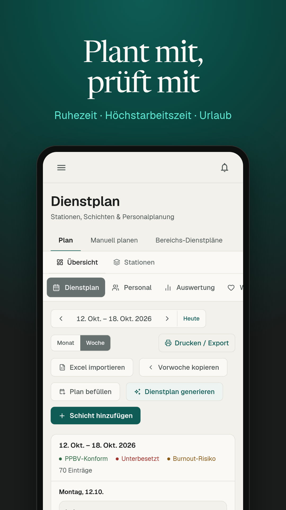
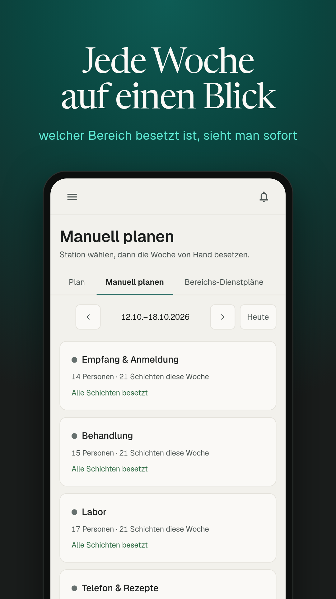
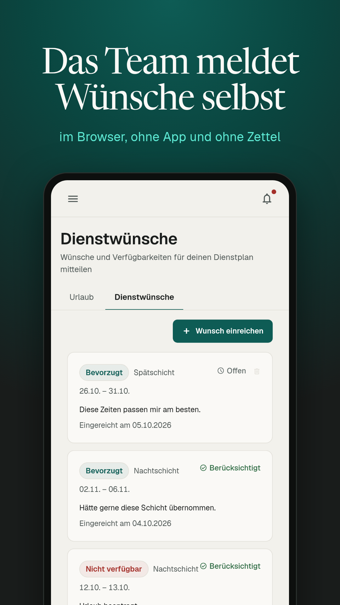

<!-- GitHub-Startseite. Liegt in .github/, damit im Download kein Markdown im Hauptordner steht.
     Für Menschen im Download: Nurvo-Community-Lies-mich.pdf (Quelle fuer-ki/README.md). Inhalt beider gleich halten. -->
<h1 align="center">Dienstplan Open Source für Arztpraxen und MVZ</h1>

<strong>Nurvo Community Edition: kostenlose Dienstplan-Software zum Selbsthosten, mit Prüfung nach Arbeitszeitgesetz.</strong>

  
   
  
  
  
  
  
  

  <a href="../docs/EINRICHTEN.md">Installation</a> ·
  <a href="../docs/pdf/Nurvo-Community-Einrichten.pdf">Anleitung als PDF</a> ·
  <a href="../docs/EINBINDEN.md">In die eigene Website einbinden</a> ·
  <a href="https://www.nurvo.de/dienstplan-open-source">Überblick auf nurvo.de</a> ·
  <a href="https://www.nurvo.de/preise">Gehostete Version</a>

Dieser Open-Source-Dienstplan läuft auf deinem eigenen Server. Plane Dienste im Browser und lass Ruhezeit, Höchstarbeitszeit und Urlaub schon beim Planen prüfen. Nurvo sieht deine Daten nicht, und die Software ruft keinen Nurvo-Server auf.

  
  
  

## Was enthalten ist

| | Community Edition | [Gehostet bei Nurvo](https://www.nurvo.de/preise) |
|---|---|---|
| Dienstplan mit Regelprüfung | ✓ | ✓ |
| Mitarbeitende, Urlaub, Wünsche | ✓ | ✓ |
| Mitarbeiter-Ansicht im Browser | ✓ | ✓ |
| Zeiterfassung | ✓ | ✓ |
| Native App | | ✓ |
| KI-Funktionen | | ✓ |
| Lohnabrechnung | | ✓ |
| Personalakte, Notfallplan | | ✓ |
| Betrieb, Updates, Backups, Support | selbst | ✓ |

## Schnellstart

Zwei Wege, beide ohne Nurvo-Server und ohne Nurvo-Lizenzschlüssel:

- **Ohne eigenen Server:** Datenbank bei Supabase (Region Frankfurt), Web-App bei Vercel. Die Schlüssel deiner eigenen Datenbank trägst du an einer einzigen Stelle ein, in den Umgebungsvariablen bei Vercel. Schritt für Schritt: [Anleitung einrichten (PDF)](../docs/pdf/Nurvo-Community-Einrichten.pdf) · [Markdown](../docs/EINRICHTEN.md)
- **Eigener Server mit Docker:** [selfhost/README.md](../selfhost/README.md)

Danach meldet sich das Team unter deiner eigenen Adresse an, zum Beispiel `dienstplan.deine-praxis.de`.

## Auf der eigenen Website zeigen

Betreibe den Plan unter einer Subdomain wie `dienstplan.deine-praxis.de` und verlinke ihn von deiner Website. Wie das geht und wann ein iframe funktioniert: [Website anbinden (PDF)](../docs/pdf/Nurvo-Community-Website-anbinden.pdf) · [Markdown](../docs/WEBSITE-ANBINDEN.md)

## Grenzen

- Die Regelprüfung ist eine Hilfe und ersetzt keine Rechtsberatung. Vollständig: [Haftungsausschluss (PDF)](../Nurvo-Community-Haftungsausschluss.pdf).
- Wer die Software betreibt, ist für Datenschutz, Backups und Updates verantwortlich. Das gilt auch für den Vertrag mit Beschäftigten und Betriebsrat.
- Sicherheitslücken bitte vertraulich melden: [Sicherheitsrichtlinie (PDF)](../Nurvo-Community-Sicherheit.pdf).

## Einrichten mit KI-Hilfe

Der Ordner [`fuer-ki/`](../fuer-ki/) enthält alle Begleittexte als Markdown, dazu die Arbeitsregeln für einen KI-Assistenten. Gib ihm diesen Ordner und [`docs/EINRICHTEN.md`](../docs/EINRICHTEN.md). Den geheimen Schlüssel `service_role` gibst du ihm nicht in den Chat. Für Menschen liegen dieselben Texte als PDF im Hauptordner, zuerst [Lies mich (PDF)](../Nurvo-Community-Lies-mich.pdf).

## Wer Nurvo baut

Nurvo ist entwickelt von **[Lilian Philipp Schiffer](https://github.com/IDKWTTAAN)**, technischer Mitgründer und Hauptentwickler. Von den rund 1.300 Commits im Nurvo-Hauptrepository stammen über 1.000 von ihm. Mitgründer sind Jonas Suthold und David. Alle Beteiligten stehen in [Autoren (PDF)](../Nurvo-Community-Autoren.pdf).

## Lizenz

[AGPL-3.0](../LICENSE). Wer die Software verändert und als Dienst anbietet, muss den geänderten Quellcode offenlegen. Der Name Nurvo und das Logo sind von dieser Lizenz nicht umfasst.

---

English

Nurvo Community Edition is an open-source, self-hosted staff scheduling tool for medical practices in Germany. It checks working-time rules while you plan and keeps all data on your own server. Overview (German): [nurvo.de/dienstplan-open-source](https://www.nurvo.de/dienstplan-open-source). The hosted version at [nurvo.de](https://www.nurvo.de/en) adds the native app, AI features and payroll.

Built by **[Lilian Philipp Schiffer](https://github.com/IDKWTTAAN)** (lead developer, about 80 % of all commits) with co-founders Jonas Suthold and David. See [authors (PDF, German)](../Nurvo-Community-Autoren.pdf).

